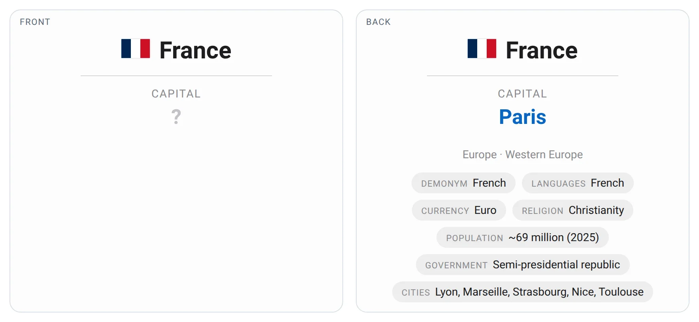
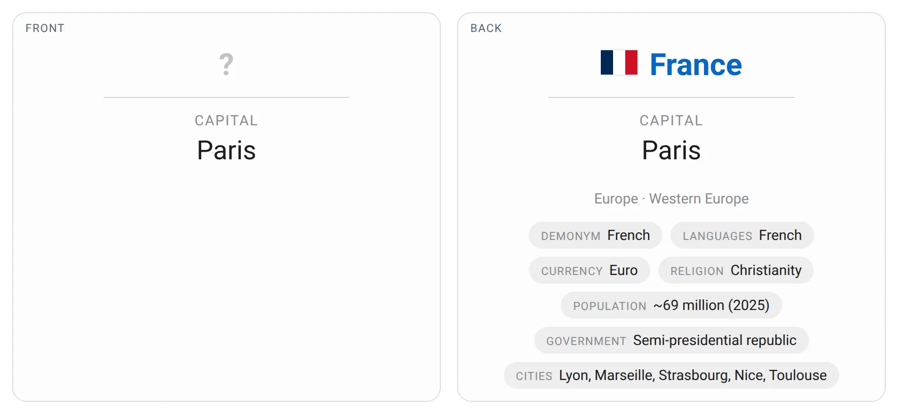
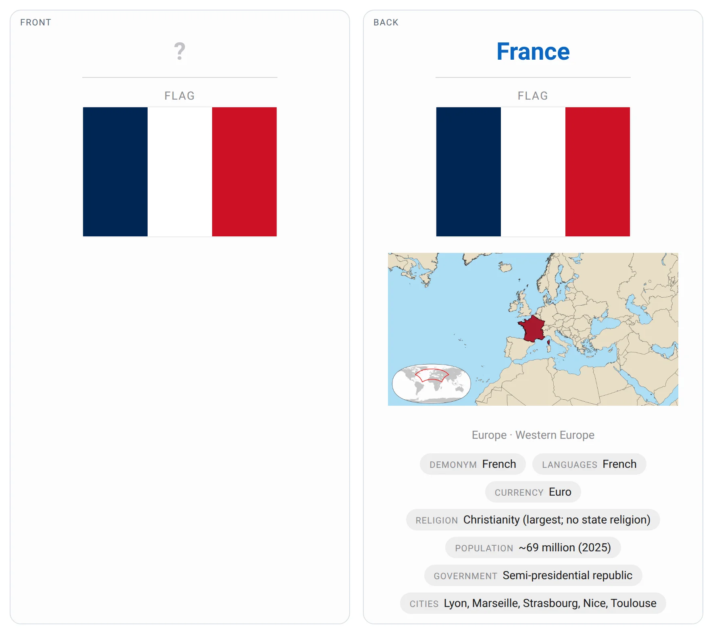
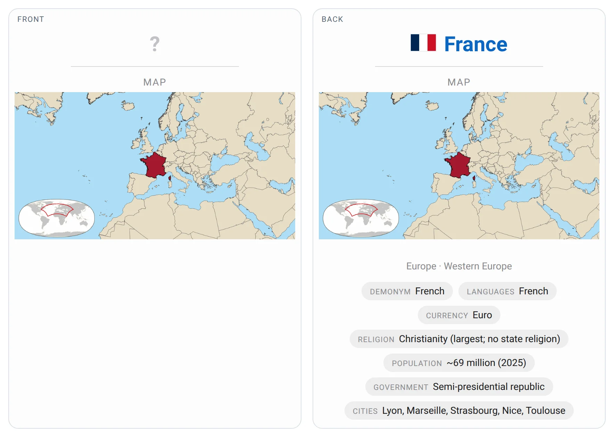
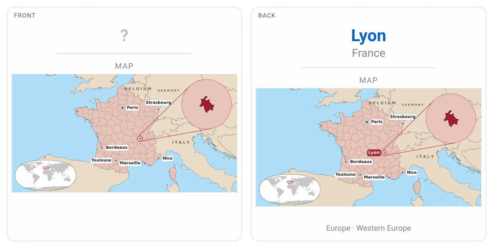
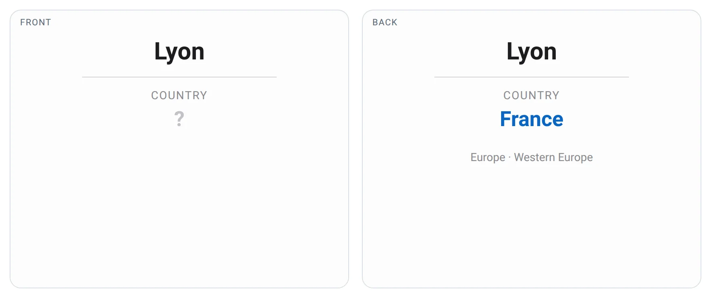
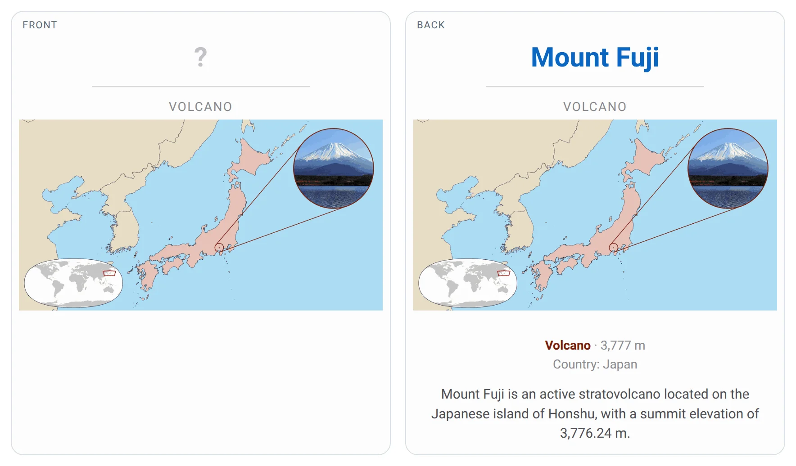
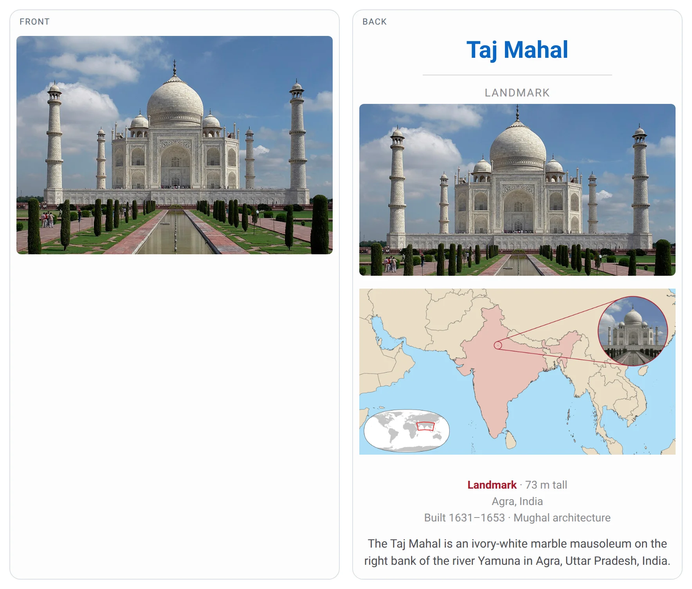

# Ultimate Countries

An Anki deck of the world's countries, territories and best-known cities, and the pipeline that builds it.

**Get the deck:** [on AnkiWeb](https://ankiweb.net/shared/info/164142051), or download `ultimate_countries.apkg` from
the [latest release](https://github.com/AminFadaee/Ultimate-Countries/releases/latest).

**Ultimate Places**, the companion deck of continents, seas, mountains, rivers, deserts, rainforests, regions and
landmarks: [on AnkiWeb](https://ankiweb.net/shared/info/216393289), or `ultimate_places.apkg` from the same release.
See [Ultimate Places](#ultimate-places) below.

It is inspired by [Ultimate Geography](https://github.com/anki-geo/ultimate-geography), the deck that got me excited
about learning geography. Ultimate Countries covers every country and territory with a permanent population: 247 in
all, each with its flag, map and capital to learn, plus demonym, languages, currency, religion, population and
government as facts on the back of the cards, and the best-known cities on the map.

Every value comes from public sources through code. There are no hand-written overrides, so the whole dataset can be
rebuilt on any day to pick up changes (new currencies, new members of an organisation, updated population figures).

## The deck

Two note types, countries and cities, all in one deck.

### Country notes

Four question cards per country:

| Question | Answer |
|---|---|
| Capital: France | Paris |
| Capital of: Paris | France |
| the flag | France |
| the locator map | France |

The back of every card also shows facts about the country: demonym, languages, currency, religion, population, form of
government and notable cities, under a line with its region. They are there to read, not to be quizzed on.

A card is only created when its data exists, and a fact that is missing is simply left out. When two countries have a capital of the same name (Jerusalem, Victoria, Kingston), the "Capital of" card is left out, because the name alone could not tell them apart.

Tap or click a country or city map to zoom in on that spot; drag to look around, and tap again to close.

<p>
  
  
  
  
</p>

### City notes

The best-known cities of the world, 185 of them in 100 countries, each with its own locator map. The map is drawn like
an atlas page: the country's other cities are marked and named, the capital with a star, and the city being asked about
is only outlined and magnified. The back of the card shows the same map with that city's name added:

| Question | Answer |
|---|---|
| the city's locator map, with the country's other cities named | City and country, with the city named on the map |
| Country: Lyon | France (not asked for capitals, which the capital cards already cover) |

<p>
  
  
</p>

### Tags

Notes are tagged so you can filter or suspend groups of them. The tags describe groups worth choosing between, never a
single country; to study one place, search for its name.

- kind: `UC::Country`, `UC::City`
- region and subregion: `UC::Asia`, `UC::Western_Europe`
- status: `UC::Sovereign`, `UC::Territory`, `UC::Disputed`
- memberships: `UC::European_Union`, `UC::NATO`, `UC::ASEAN`, …
- cities: `UC::Capital`, and `UC::Most_visited` for those on Wikipedia's most-visited cities lists

### Everything in one deck

Ultimate Countries has no subdecks. To study one group or one kind of question at a time, create a filtered deck:

1. Tools → Create Filtered Deck
2. Search for one of these (or join several with `or`):
   - `deck:"Ultimate Countries" tag:UC::Asia` for a region, or any other tag
   - `deck:"Ultimate Countries" "note:Ultimate Countries country" card:Flag` for one kind of question (Capital, Capital of,
     Flag or Map). Keep the note type in the search, because cities have a card called Map too
   - `deck:"Ultimate Countries" tag:UC::City` for the cities
3. Build

To leave a kind of card out for good, search for it in the Browser and suspend the cards: deleted cards come back when
you import an update.

## Ultimate Places

A second deck about the world's geography beyond borders: 386 places, each drawn on a map with its real outline,
coloured by kind (snowy white for mountains, orange for deserts, blue for water, green for lowlands and so on).

**Get the deck:** [on AnkiWeb](https://ankiweb.net/shared/info/216393289), or download `ultimate_places.apkg` from the
[latest release](https://github.com/AminFadaee/Ultimate-Countries/releases/latest).

### Cards

| Question | Answer |
|---|---|
| the map, with the kind of place (MOUNTAIN RANGE, DESERT…) and, when the place has one, its photo inside the magnifying circle (in the corner when the map has no magnifier) | its name, with countries, one fact, a one-sentence description from Wikipedia and, for landmarks, the city and when it was built |
| a photo (mountains, volcanoes, waterfalls, canyons, reefs, rainforests, canals and landmarks) | its name, kind, map and the same details |

<p>
  
  
</p>

### Everything in one deck

Ultimate Places has no subdecks. Every note is tagged with its kind and continent, for example `UP::Volcano`,
`UP::Mountain_range`, `UP::Africa` or `UP::World_Heritage`. To study one kind at a time, create a filtered deck:

1. Tools → Create Filtered Deck
2. Search for `deck:"Ultimate Places" tag:UP::Volcano` (or any other tag, or several joined with `or`)
3. Build

To leave a kind out for good, open the Browser, search for its tag and suspend the cards.

### Kinds and sources

| Kind | Source | Rule |
|---|---|---|
| Continents | Natural Earth | All of them |
| Oceans and seas | Marine Regions (the IHO sea areas), Natural Earth for seas IHO doesn't cover (Caspian) | Linked to Wikidata; halves and basins merge into the whole sea, and marginal seas into the sea they belong to |
| Mountain ranges, deserts, plateaus, plains, basins, valleys, deltas, wetlands, peninsulas, isthmuses | Natural Earth physical regions | Natural Earth's importance rank, plus enough Wikipedia coverage to be well known |
| Rivers, lakes, reefs | Natural Earth | Same as above |
| Mountains and volcanoes | Natural Earth peaks and Wikidata | Well known; volcanoes by their Wikidata type |
| Waterfalls, canyons, canals | Wikidata, with shapes from Natural Earth and OpenStreetMap | The best known of each kind |
| Rainforests | RESOLVE Ecoregions 2017 | Large continuous blocks of tropical moist forest, named after the forest or the basin or island they cover |
| Regions | Wikipedia, Natural Earth | Regions whose Wikipedia infobox lists their countries (Scandinavia, the Middle East…), drawn from those countries; Natural Earth's own outline is used where the listed countries only partly belong to the region (the Sahel) and for island groups (Melanesia, Micronesia, Polynesia). Siberia is built from the Russian provinces that Wikidata lists as its parts |
| Landmarks | Wikidata, OpenStreetMap | World Heritage sites and famous structures that are buildings, monuments or archaeological sites; living cities are left out. When Wikidata says one landmark is part of another that is also in the deck (the Great Pyramid in the Giza complex), only the more widely covered one is kept. Walls (the Great Wall, Hadrian's Wall) are drawn as lines from OpenStreetMap, joined across gaps of up to about 40 km |
| Lines | Natural Earth | The Equator, the tropics, the polar circles and the International Date Line, plus the Prime Meridian |

Countries are computed from the shapes: the countries that hold a share of an area, border a sea or lake, contain a point or are
crossed by a line or river. A country that Wikidata names for a place is added only if it lies within 50 km of it. Continents come from the Natural Earth continent shapes, so Siberia is in Asia and Martinique in the Americas. Facts (heights, lengths, areas) come from Wikidata, converted to metric; build dates and cultures
from the Wikipedia infobox; the sentence on the back of each card from the English Wikipedia summary; photos from Wikimedia Commons, with their author and licence recorded in `data/places/CREDITS.md`. A place inside a disputed area is listed with its city only, not a country.

## How the data is chosen

| Field | Source | Rule |
|---|---|---|
| Country list | ISO 3166, restcountries | Every entity with an ISO 3166 code, plus sovereign states without one (Kosovo, Abkhazia…), keeping only places with a permanent population: listed in Wikipedia's population list, or at least 2,250 people |
| Name | Wikipedia | The title of the country's English Wikipedia article, which follows the most common English name |
| Subregion | Unicode CLDR | The UN geoscheme subregion of each country |
| Demonym, currencies, government label, capitals | restcountries | Demonym spelling cross-checked with Wikidata |
| Capital cities, notable cities, city populations | Wikidata, GeoNames | Up to five notable cities per country rank on fame (Wikipedia sitelinks) and size, skipping suburbs, villages, islands, archaeological sites and administrative divisions. Cities are named by the shorter of their Wikidata label and English Wikipedia title. They are the "Cities" chip on the cards and the labels on the city maps |
| City cards | Natural Earth populated places, Wikidata, Wikipedia | A city that Wikipedia covers in at least 180 languages, that has at least 100,000 people and that its English article read at least 25,000 times in the past year, or one on Wikipedia's most-visited cities lists (Euromonitor, Mastercard) with at least 100 languages (and the same readership). At most eight per country, ranked by fame and size; cities that are countries themselves are left out |
| Population | World Bank | Latest figure, at most 5 years old; restcountries otherwise |
| Official languages | Wikipedia, Wikidata | National and regional status from Wikipedia's list of official languages |
| Spoken languages | Unicode CLDR | Includes second-language speakers |
| State religion | Wikipedia | Current states with a state religion |
| Religious composition | Pew Research Center | 2020 figures; places under 100,000 people are not covered |
| Main currency | ISO 4217 | A real ISO currency, preferring the country's own |
| Government form | restcountries, Wikidata | Short form derived from the full label by keyword rules |
| Memberships | restcountries, Wikidata | Wikidata adds only recent joins that both sides of the membership record |
| Maps | Natural Earth, OpenStreetMap | Rendered locally. Disputed areas in Natural Earth are shaded on the map of every country that claims or administers them |

When sources disagree and no rule settles it, the field is left empty rather than guessed.

## Building it yourself

Requires Python 3.13 and [uv](https://docs.astral.sh/uv/).

```sh
uv sync
echo 'RESTCOUNTRIES_API_KEY=your-key' > .env
```

```sh
uv run geography collect      # fetch data, flags, city lists and render maps into data/
uv run geography check        # accuracy against the reference set, anomalies, card and fact coverage
uv run geography deck         # build build/ultimate_countries.apkg
uv run geography places       # collect places, photos and maps into data/places/
uv run geography places-deck  # build build/ultimate_places.apkg
uv run geography samples      # render the sample cards in docs/samples/ from the built decks
```

The first `collect` downloads several hundred MB of source data and renders about 620 maps, which takes a few hours.
Later runs reuse the caches.

Useful options:

- `collect --skip-maps` refreshes the data only
- `collect --refresh-cities` re-ranks notable and famous cities, which are otherwise refreshed every 30 days
- `collect --only-cities` selects the famous cities and renders their maps without refreshing any other data
- `collect --rerender-maps` redraws every map that has changed. Maps are kept in `src/geography/cache/maps` under a fingerprint of everything they are drawn from (the shapes, labels, drawing code, base data and library versions), so a map that nothing has changed is copied rather than redrawn, and an interrupted run picks up where it stopped. Delete that folder to redraw everything
- `collect --workers N` sets the number of parallel map renderers (default 4)
- `check --details` lists every failure and anomaly
- `places --rerender-maps` redraws every place map that has changed, using the same cache

`place` renders a map for any single place, independent of the deck:

```sh
uv run geography place "Bruges" --country Belgium --borders regions
```

## Releasing

Releases are built by GitHub Actions from the committed data, flags and maps.

```sh
uv run geography collect
uv run geography check
uv run geography places
git add data
git commit -m "Update data"
git push
git tag v$(date +%Y.%m.%d)
git push origin v$(date +%Y.%m.%d)
```

Versions are dates, so the version says how fresh the data is. Pushing the tag builds `ultimate_countries.apkg` and
`ultimate_places.apkg` and publishes them as a release under that tag.

## Quality checks

`reference/countries.json` holds hand-checked answers for 46 countries. It is only used to measure accuracy and never
feeds into the data. `geography check` scores every field against it, scans all entries for anomalies (duplicate
languages, capitals smaller than they should be, contradictory flags) and reports how many countries have each card and fact.

## Repository layout

```
src/geography/
  main.py           command line
  collect.py        the collection pipeline
  sources/          one module per data source
  languages.py      merging official and spoken languages
  cards.py          turns a country into card answers
  deck.py           builds the Anki package
  render.py, maps.py, detail.py
                    locator maps
  quality.py        reference scoring and anomaly scan
  samples.py        renders the sample cards shown in this README
  features/         Ultimate Places: selection rules, maps and deck
data/
  countries/        one JSON file per country (the exported dataset)
  flags/            flag SVGs
  maps/             locator maps for countries and cities
  places/           Ultimate Places: one JSON file per place, maps and photos
reference/          hand-checked answers for the quality check
docs/samples/       sample cards for this README
```

The built deck is not stored in the repository; it is attached to each release.

## Licence

The code is released under the [MIT licence](LICENSE). The data keeps the licences of its sources:

- Wikidata: CC0
- Wikipedia: CC BY-SA
- OpenStreetMap: ODbL
- GeoNames: CC BY
- Natural Earth: public domain
- Marine Regions (IHO sea areas): CC BY
- RESOLVE Ecoregions 2017: CC BY
- Wikimedia Commons photos: each under the licence given on its Commons page
- Unicode CLDR: Unicode License
- restcountries, World Bank, Pew Research Center, IMF and ISO 4217 data are used under their respective terms
